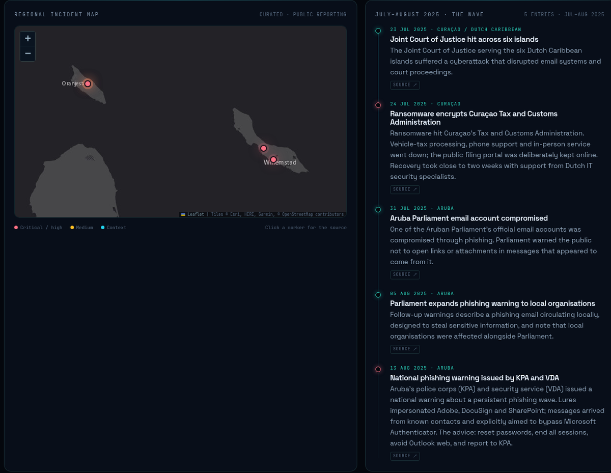

**Update — 5 November 2026.** This started as a project note. It is now a running platform: OpenCTI and MISP on Proxmox, a public radar, a weekly brief and a reproducible repository. The current scope is Aruba, Bonaire and Curaçao; Sint Maarten coverage is paused. The original reasoning is below, followed by what was actually built, what it sees, and what is still missing.

## Why this initiative

There is no centralized or dedicated source on Facebook or other social media platforms that provides real-time updates on cybersecurity threats specific to Aruba. When local companies experience security breaches, the public and their clients are often not notified.

I want to address this gap with consistent weekly, or even daily, posts about ongoing cyber threats targeting Aruba and the Caribbean region — including Curaçao and Bonaire. These updates cover active threats and practical steps for individuals and organizations to protect themselves.

Raising awareness is critical, especially given the wave of phishing attacks — including Tycoon 2FA-style adversary-in-the-middle kits — that breached government and other entities in 2025.

## The gap is not information. It is structure.

There is no shortage of global threat intelligence. There is a shortage of **local** threat intelligence: a consistent, structured, public record of what is happening to these islands, written by someone who lives here and can tell the difference between a global feed and a local incident.

News reporting gives us the what, usually after the fact, often in fragments. It rarely gives us the techniques in a form defenders can map to controls, the indicators in a form a SOC can ingest, or the pattern across islands and sectors. A threat intelligence platform fixes the structure: STIX 2.1 objects and relationships, not another PDF.

## What is running now

The platform is deployed on a dedicated Proxmox VM (8 vCPU, 20 GB RAM, Debian 13):

- **OpenCTI 7.261103.0** as the STIX knowledge graph, with Elasticsearch, Redis, RabbitMQ and S3-compatible storage.
- **MISP 2.5.51** as the ingestion and normalisation layer, with public OSINT feeds and the official OpenCTI connector.
- **A collector** that queries the OpenCTI GraphQL API, applies a field allow-list and writes a public JSON snapshot.
- **A static radar and blog** built with Astro, ECharts and Leaflet, served by Caddy on the LAN and mirrored on GitHub Pages.
- **A reproducible repository** with Compose files, connector configuration, runbooks, backup and refresh scripts.

The public radar is here: **[kevinflorencio.github.io/opencti-aruba](https://kevinflorencio.github.io/opencti-aruba/)**. The code and documentation are at **[github.com/KevinFlorencio/opencti-aruba](https://github.com/KevinFlorencio/opencti-aruba)**.

At the time of writing, the graph holds **4 reports, 886 indicators, 1,512 observables, 1,154 known-exploited vulnerabilities and one campaign**. MISP has ingested **203 events / 14,934 attributes** from five public feeds, and two keyless OpenCTI connectors add active phishing URLs and ransomware leak-site claims.

## Architecture, briefly

The rule is simple: **the platform is not the publication**. OpenCTI is never exposed to the internet. A collector queries it over loopback, selects a fixed set of fields, and writes `latest.json`. The static site renders that file; there is no API token in the browser and no way to pivot from the public page into the graph.

MISP consumes the messy OSINT feeds, applies warning lists and deduplication, and hands events to OpenCTI. Reference connectors (MITRE ATT&CK, MITRE ATLAS, CISA KEV, OpenCTI datasets) provide the vocabulary and the vulnerability baseline. The regional layer — the incident timeline, ATT&CK coverage and the briefings — is curated by hand from public reporting, with a source link on every entry.

That separation is what makes the radar publishable. A public dashboard that queries a live CTI platform directly is an attack surface; a snapshot is a static file.

## Sources

Five MISP feeds: **CIRCL OSINT, Botvrij.eu, abuse.ch Feodo Tracker, OpenPhish and Emerging Threats compromised IPs**. Two keyless connectors: **Phishunt** for active phishing URLs and **RansomLook** for ransomware leak-site claims. Reference data comes from **MITRE ATT&CK, MITRE ATLAS, CISA KEV and the OpenCTI datasets**.

One source had to be removed. abuse.ch retired the public URLhaus bulk CSV and MISP feed; the endpoint now returns **HTTP 410 Gone**. The connector was disabled, not left in a restart loop, and the source catalogue documents why. This is the least glamorous part of running a CTI programme and the part most likely to be skipped: **verify the feed endpoint before you trust the dashboard**.

## The regional layer

The July–August 2025 wave is the reference case. The [Joint Court of Justice](https://therecord.media/aruba-curacao-governments-cyberattacks) serving six Dutch Caribbean islands was hit on 23 July. [Curaçao's Tax and Customs Administration](https://nltimes.nl/2025/08/02/ransomware-attacks-cripple-government-services-across-dutch-caribbean-islands) suffered ransomware on 24 July. Aruba's Parliament confirmed a compromised email account on 31 July, and on 13 August the Korps Politie Aruba and Veiligheidsdienst Aruba issued a [national phishing warning](https://www.gobierno.aw/nl/nationale-waarschuwing-gevaarlijke-phishing-e-mails-in-omloop-op-aruba) describing lures that bypassed Microsoft Authenticator.

The radar maps those incidents, the ATT&CK techniques they imply, and the indicators arriving now. Three briefings go deeper: [the July–August wave](https://kevinflorencio.github.io/opencti-aruba/blog/dutch-caribbean-cyber-wave/), [why MFA was not a wall](https://kevinflorencio.github.io/opencti-aruba/blog/mfa-is-not-a-wall/), and [how the platform is built](https://kevinflorencio.github.io/opencti-aruba/blog/introducing-aruba-threat-radar/).

## What gets published — and what does not

Public output is **TLP:CLEAR** only. Indicators are defanged in the browser. Victim identities and personal data are excluded. Attribution stays absent unless there is public evidence; "unknown" is an acceptable answer.

The platform keeps the rest: connector metadata, sensitive reports, internal notes and any feed whose licence does not permit redistribution. The public site never receives an OpenCTI token.

## What I learned

1. **Feed endpoints rot.** URLhaus is the example this month. A feed can look healthy in a source table while returning 410 to every request.
2. **The MISP Docker image has sharp edges.** php-fpm listens on IPv6 while the healthcheck probes IPv4, so nginx never starts; the Redis session handler rejects the image's own auth query string and returns HTTP 500; advanced auth keys silently bind to the caller's IP. All three are fixed in the repository and written down in `docs/MISP.md`, because the next deployment should not lose an evening to them.
3. **The disk is the bottleneck.** The VM currently lives on a USB-attached HDD. It works, and it is the first thing I will move to NVMe before enabling heavier feeds.
4. **Zero counts are honest.** Malware and threat-actor objects are still at zero because most public feed events do not carry the galaxies or object templates that would create them. The next coverage job is enabling MISP galaxies and object templates, not inflating the dashboard.
5. **The publication layer is the differentiator.** OpenCTI alone is a hobby. A radar that a local journalist, a school IT lead or a hotel manager can open, understand and act on is the actual product.

## What changed since publication

The first version of this post ended with a list. Most of it is now running:

- **The graph has malware and actors.** The MITRE ATT&CK connector was registering with an invalid scope, so the platform accepted the connector but silently dropped the bundle. Fixing the scope produced **746 malware objects, 96 tools, 185 intrusion sets and 58 campaigns**; MISP now exposes **136 galaxies / 58,117 clusters / 555 object templates**, and its threat-guessing option is on.
- **The briefs are bilingual.** Every post carries a Dutch and Papiamento summary. English-only intelligence is a filter on who can use it.
- **The cadence is automated.** A systemd timer runs the collector every Monday at 07:00 AST and writes a numbered brief draft to `drafts/`. A human still edits it; that is deliberate.
- **The analyst view exists.** Three OpenCTI dashboards — *Aruba Watchlist*, *KEV Exposure* and *Ingestion Pulse (24h)* — render live counts over the graph, alongside the public radar.
- **The graph has a snapshot.** Elasticsearch has a filesystem repository and a daily SLM policy; the first snapshot completed with 16/16 shards successful.

Two items are not finished:

- **OTX and AbuseIPDB are wired but need keys.** Both connectors are behind Compose profiles so the stack does not fail without them. The AbuseIPDB connector supports `ABUSEIPDB_ONLY_COUNTRY=AW,CW,BQ`; OTX has no country filter and is context, not a local feed.
- **The NVMe move is blocked, not done.** The VM disk is 100 GB; the thin pool has ~52 GB free, and the USB-backed disk resets under sustained random I/O. A shrink-and-copy migration would risk the only copy of the graph for a marginal gain. The correct order is a block-level clone to a healthy disk, then a shrink, then the move. The snapshot repository is the safety net until that happens.

## What's next

- Get the OTX and AbuseIPDB keys into `.env`, then `docker compose --profile otx --profile abuseipdb up -d`.
- Clone the VM disk to healthy storage before attempting the NVMe move; the current disk is the weakest link, not the CPU.
- Publish the weekly draft every Monday, and keep the analyst dashboards current as the feed mix changes.

If you run an organisation on the island and want to contribute an incident, a phishing sample or a correction, the contact route is on the radar's [about page](https://kevinflorencio.github.io/opencti-aruba/about/#contact). Victim identities are never published, and the source of a report is not disclosed without permission.
