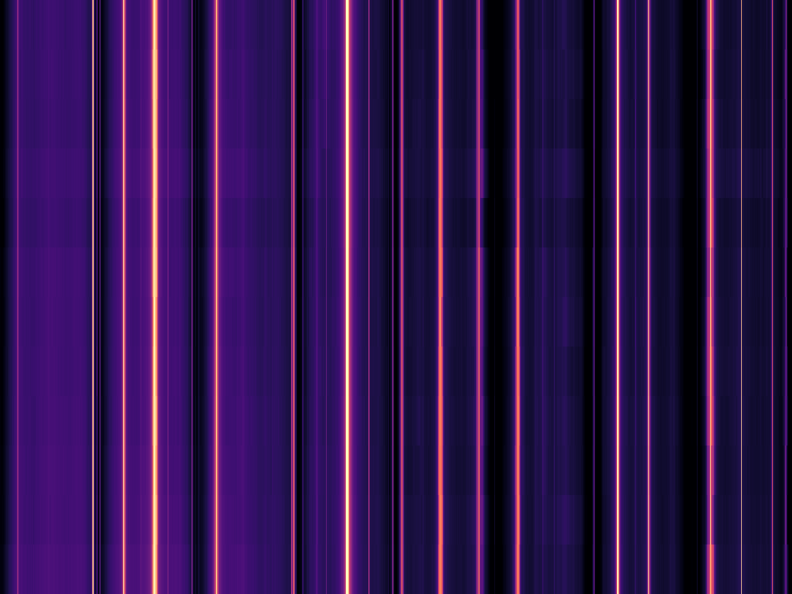

Most software-defined radio guides assume you live in the US or Europe. The hardware
advice travels; the frequencies, the airport channels, the marine traffic and the legal
framework do not. Aruba is small enough that nobody had written the local version, so I
built one.

**The guide is built, but not published.** I took the site offline while the frequency
catalogue is being verified: the code, the raw scans and the experiment notes live in a
private repository for now.

## What it is

A legal, reproducible RTL-SDR field guide for Aruba:

- **67 curated signals** — FM/AM broadcast, the Reina Beatrix airband, marine VHF, AIS,
  amateur repeaters, ADS-B, NOAA/Meteor/GOES weather satellites, GPS, ISM and the hydrogen
  line. Every row has a mode, bandwidth, legal status and a source URL.
- **A Python scanner** that drives `rtl_power`, parses the raw CSV, estimates a local noise
  floor, finds peaks and matches them against the catalogue. Each run produces a Markdown
  report, `peaks.csv`, JSON metadata and two figures.
- **An audio capture command** for `rtl_fm` with AM/NFM/WFM/USB/LSB and metadata.
- **Experiment notes** on RDS, a NOAA APT capture and a 1420 MHz hydrogen-line attempt —
  held back from the public build until they are checked against the local spectrum.
- **A blog and reference section** with the Aruban legal notes and the full source list.

The whole thing is a private GitHub repository with CI, a strict docs build and a deploy
workflow that is deliberately disabled. Nothing is published while the catalogue is being
verified; when it is, the guide goes up as a static site.

## The legal line

An RTL-SDR is receive-only. It has no transmit hardware, and the project never asks it to
transmit. That matters in Aruba: the **Telegraaf- en telefoonverordening** (AB 1996 GT 2)
requires permission for transmitting and receiving apparatus, but Article 4(2) says
permission for a receiver can only be refused in narrow circumstances, and Article 4a
exempts type-approved equipment in the public register. The practical reading is that
ordinary reception is normal; transmitting without authorisation is not.

The guide deliberately excludes public-safety, security, encrypted business radio, pagers,
phone calls and cellular user traffic. It also does not publish live AIS/ADS-B tracks of
named private vessels or aircraft. The public services are interesting enough.

## The signals worth starting with

- **118.000 MHz** — Beatrix Tower at Queen Beatrix International. AM, 25 kHz. The current
  eAIP lists 118.000 as tower and 120.900 as approach; a lot of older hobby pages get this
  backwards.
- **1090 MHz** — ADS-B. Every modern airliner broadcasts identity, altitude, speed and
  position in the clear.
- **161.975 / 162.025 MHz** — AIS. Cruise ships, cargo and fishing boats around Oranjestad
  and Barcadera.
- **137.100 MHz** — NOAA 19 APT. A weather satellite image downlinked as an analogue audio
  signal.
- **1420.405751 MHz** — the hydrogen line. About 30 dB below the noise floor of a bare
  RTL-SDR, which is what makes it a good antenna and integration project.

## How the scan pipeline works

<figure class="post-float">
  
  <figcaption>FM band, 87.5–108 MHz: frequency across, sweeps down. Each bright vertical line is a carrier that stayed put.</figcaption>
</figure>

`rtl_power` writes a matrix of sweeps × frequency bins. The naive approach — median across
time per bin — fails on a continuous carrier because the carrier becomes the "noise". The
scanner instead estimates a local floor from a wide slice of neighbouring frequencies on
each sweep, then takes the median over time. Peaks are grouped into candidates with
frequency, bandwidth, power, SNR and persistence. A catalogue match is labelled as a
hypothesis, not an identification.

The report includes a section called **"What this scan cannot tell you"** because an 8-bit
receiver with a 25 kHz bin is not a spectrum analyser. The raw CSV is always kept next to
the report.

## What is next

The first real survey is done: the FM dial from Oranjestad, 87.5–108 MHz, twelve sweeps at a
fixed 40.2 dB gain. Fourteen of the twenty strongest carriers matched catalogue entries —
Massive FM 103.5, Caliente 90.7 and Fresh FM 104.3 among them — and the unmatched ones are
the interesting part. Airband, marine and 1090 MHz are next, then the same run from San
Nicolas for comparison.

If you are in Aruba, have an SDR and want to help check the catalogue, get in touch. A local
observation is worth more than another web source, and the frequency table goes public once
it survives that check.
